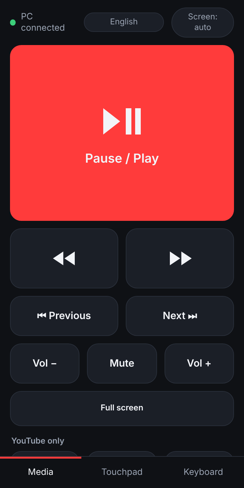
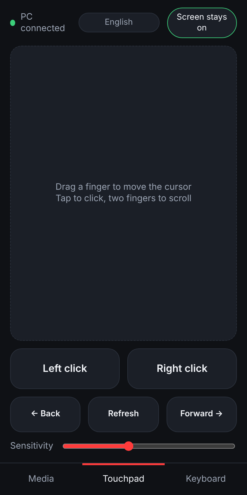
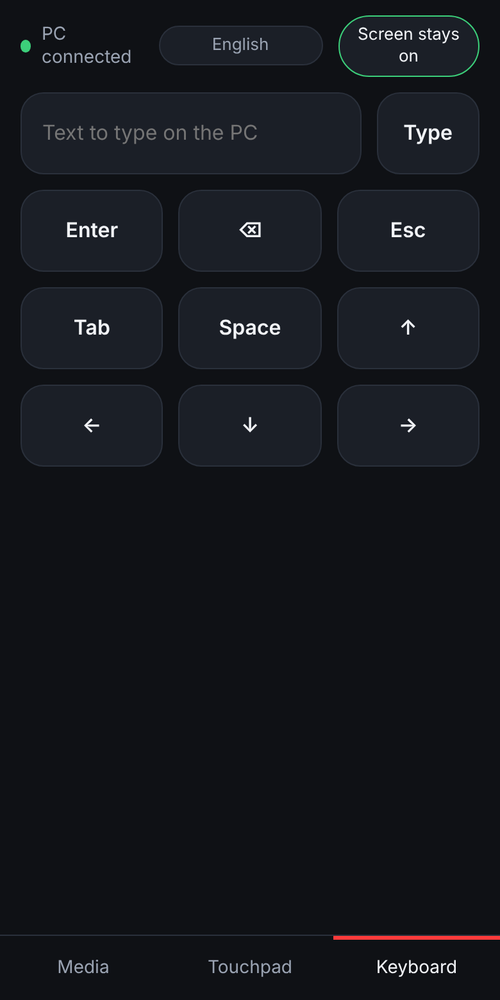
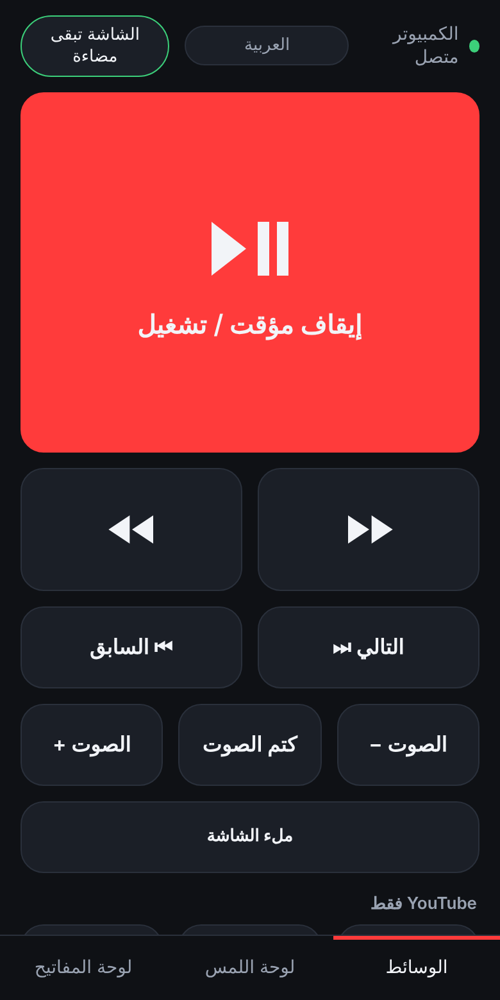
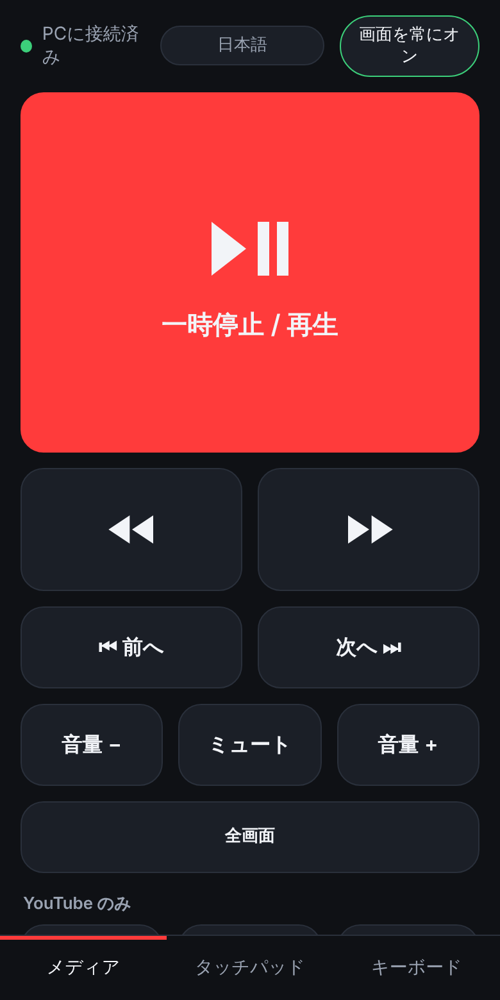
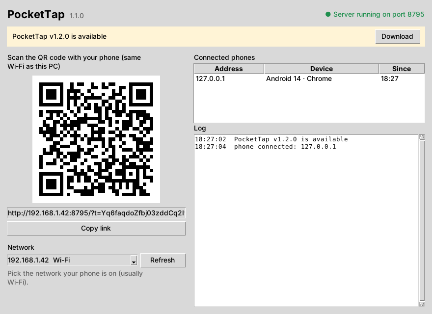

# PocketTap

**English** · [العربية](docs/README.ar.md) · [中文](docs/README.zh.md) · [日本語](docs/README.ja.md) · [Русский](docs/README.ru.md) · [Deutsch / Schweiz](docs/README.de.md)

Turn your phone into a remote control for your PC over home Wi-Fi. Built for watching YouTube on the computer while on a treadmill, and controlling the video from the phone.

[-2ea44f?style=for-the-badge&logo=windows&logoColor=white)](https://github.com/universe-coder/pocket-tap/releases/latest/download/PocketTap-windows.exe)
[-555?style=for-the-badge&logo=github)](https://github.com/universe-coder/pocket-tap/archive/refs/heads/main.zip)

[](https://github.com/universe-coder/pocket-tap/releases/latest)
[](https://github.com/universe-coder/pocket-tap/releases)
[](https://github.com/universe-coder/pocket-tap/actions/workflows/tests.yml)
[](LICENSE)


[](https://github.com/universe-coder/pocket-tap/stargazers)

## Screenshots

<table>
<tr><td align="center"><br><sub>Media</sub></td><td align="center"><br><sub>Touchpad</sub></td><td align="center"><br><sub>Keyboard</sub></td></tr>
<tr><td align="center"><br><sub>Arabic, right to left</sub></td><td align="center"><br><sub>Japanese</sub></td><td></td></tr>
</table>

<p align="center"><br><sub>PC program: scan the QR code with your phone</sub></p>

Two parts:

- **The PC program** (`pc_remote`, Python) presses keys and moves the mouse on commands from the phone. Windows is the main platform; macOS and Linux (X11) work too.
- **The phone app** is a web app (PWA) that the PC serves over Wi-Fi. Nothing to install from an app store: scan a QR code and optionally add it to the home screen, where it opens like a regular app. Works on Android and iPhone.

The phone app speaks English, Arabic (right to left), Chinese, Japanese, Russian, German and Swiss German. It follows the phone's language, and you can switch it at the top of the screen.

## Features

**Media**: works with any player (YouTube, Netflix, Spotify, VLC and others): a big play/pause button, rewind and fast forward (hold to keep seeking), next and previous, system volume, full screen. For YouTube there are also playback speed and captions.

**Touchpad**: move the cursor with a finger, tap to click, two-finger tap to right-click, two-finger scroll, and Back, Forward and Refresh buttons for the browser.

**Keyboard**: type text on the PC (for example, a YouTube search), Enter, Esc, arrows and other keys.

**PC window**: the QR code, a network picker (if the phone can't connect, pick the network it is on, usually Wi-Fi), the list of connected phones and a log. Closing the window keeps PocketTap running in the tray on Windows (minimized on macOS and Linux); quit from the tray icon's menu. The program checks GitHub for a new version and offers to download it.

## Getting started

### Windows: one file, no Python needed

1. Download [PocketTap-windows.exe](https://github.com/universe-coder/pocket-tap/releases/latest/download/PocketTap-windows.exe) and run it.
   Windows may warn about an unknown publisher because the program is not code-signed: click **More info**, then **Run anyway**.
2. When Windows asks about network access, allow it for **private networks**.
3. A QR code appears in the window. Scan it with your phone camera; the phone must be on the same Wi-Fi.
4. To open the remote with one tap, add it to the home screen from the phone browser's menu.

### Any system, with Python

1. Install [Python 3.9+](https://www.python.org/downloads/). On Windows, tick "Add python.exe to PATH" during setup.
2. [Download the ZIP](https://github.com/universe-coder/pocket-tap/archive/refs/heads/main.zip), unpack it and run:
   - Windows: double-click `start-windows.bat`
   - macOS / Linux: `./start.sh`

   The first run installs dependencies, which takes about a minute. On macOS, allow the terminal under System Settings → Privacy & Security → Accessibility so it can press keys.
3. Continue from step 2 above.

The pairing key is saved, so you don't need to scan again after restarting the PC. To issue a new key (old phones get disconnected): `--reset-token`, for example `start-windows.bat --reset-token`.

The PC program prints its messages in the system language; choose another one with `--lang en|ar|zh|ja|ru|de|gsw`.

Run `--console` to use the terminal instead of a window, or `--minimized` to start hidden in the tray.

## How media control works

- **Play/pause, next, previous and volume** use media keys, so they reach whatever is playing even when its window isn't focused.
- **Rewind, fast forward and full screen** press the arrow keys and F, which most players understand, so the player window has to be focused. If they do nothing, open the Touchpad tab and click the video. **Speed and captions** are YouTube hotkeys.

## Phone screen

To keep the screen on while you're on the treadmill, the app tries to enable "keep screen on" (the button at the top). Browsers only allow that over HTTPS, while the remote uses plain HTTP inside the home network, so on most phones the button shows "system setting". Until then, raise the screen timeout in the phone's settings.

## Security

Commands are accepted only from a phone with the key from the QR code. The key is stored in `%APPDATA%\pc-remote\token` (Windows) or `~/.pc-remote/token`. Traffic is not encrypted: use the remote only on your home network. See [SECURITY.md](SECURITY.md) to report a vulnerability.

## For developers

```sh
python -m pip install -r requirements.txt -r requirements-dev.txt
python -m pytest
python -m pc_remote --dry-run   # log commands instead of pressing keys
```

Layout:

- `pc_remote/actions.py`: which keys each button presses
- `pc_remote/app.py`: HTTP and WebSocket server, message validation
- `pc_remote/backend.py`: key presses through pynput, and the dry-run mode
- `pc_remote/gui.py`: the PC window and tray icon; `server.py` runs the server beside it
- `pc_remote/updates.py`: the GitHub release check
- `pc_remote/i18n.py`: the PC program's messages in every language
- `pc_remote/static/`: the phone app; translations live in `static/locales/`

Releases: pushing a tag such as `v1.0.0` (or running the release workflow with a version) builds `PocketTap-windows.exe` and publishes it on the [Releases](https://github.com/universe-coder/pocket-tap/releases) page. See [CONTRIBUTING.md](CONTRIBUTING.md), including how to add a language.

## License

[MIT](LICENSE)
