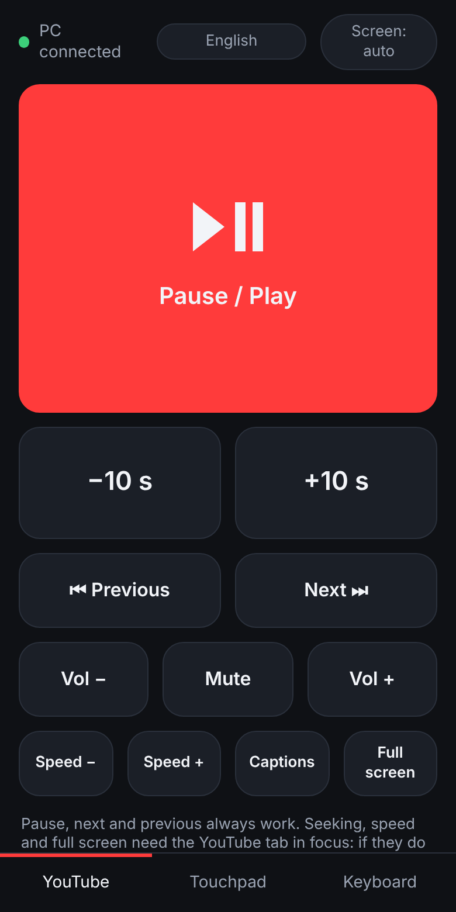
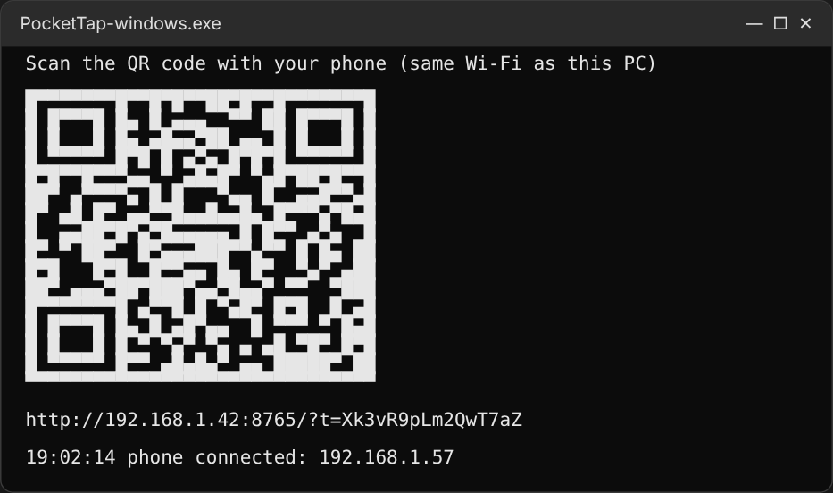

# PocketTap

[English](../README.md) · [العربية](README.ar.md) · [中文](README.zh.md) · [日本語](README.ja.md) · [Русский](README.ru.md) · **Deutsch / Schweiz**

Das Handy wird zur Fernbedienung für den PC, über das WLAN zu Hause. Gedacht zum Beispiel, um auf dem Laufband YouTube am Computer zu schauen und das Video vom Handy aus zu steuern.

[-2ea44f?style=for-the-badge&logo=windows&logoColor=white)](https://github.com/universe-coder/pocket-tap/releases/latest/download/PocketTap-windows.exe)
[-555?style=for-the-badge&logo=github)](https://github.com/universe-coder/pocket-tap/archive/refs/heads/main.zip)

## Screenshots

<table>
<tr><td align="center"><br><sub>YouTube</sub></td><td align="center"><br><sub>Touchpad</sub></td><td align="center"><br><sub>Tastatur</sub></td></tr>
<tr><td align="center"><br><sub>Arabisch, von rechts nach links</sub></td><td align="center"><br><sub>Japanisch</sub></td><td></td></tr>
</table>

<p align="center"><br><sub>PC-Programm: QR-Code mit dem Handy scannen</sub></p>

Zwei Teile:

- **Das PC-Programm** (`pc_remote`, Python) drückt Tasten und bewegt die Maus auf Befehl des Handys. Hauptplattform ist Windows; macOS und Linux (X11) funktionieren ebenfalls.
- **Die Handy-App** ist eine Web-App (PWA), die der PC selbst über das WLAN bereitstellt. Nichts aus dem App Store installieren: QR-Code scannen und auf Wunsch zum Startbildschirm hinzufügen, dann öffnet sie sich wie eine normale App. Läuft auf Android und iPhone.

Die Handy-App spricht Englisch, Arabisch (von rechts nach links), Chinesisch, Japanisch, Russisch, Deutsch und Schweizerdeutsch. Sie folgt der Sprache des Handys und lässt sich oben auf dem Bildschirm umstellen.

## Funktionen

**YouTube**: große Pause/Play-Taste, ±10 Sekunden spulen (gedrückt halten zum Weiterspulen), nächstes und vorheriges Video, Systemlautstärke, Wiedergabetempo, Untertitel, Vollbild.

**Touchpad**: Zeiger mit dem Finger bewegen, Tippen ist ein Klick, Tippen mit zwei Fingern ein Rechtsklick, Scrollen mit zwei Fingern, dazu Zurück, Vor und Neu laden für den Browser.

**Tastatur**: Text auf dem PC eingeben (zum Beispiel eine YouTube-Suche), Enter, Esc, Pfeiltasten und weitere Tasten.

## Loslegen

### Windows: eine Datei, ohne Python

1. [PocketTap-windows.exe](https://github.com/universe-coder/pocket-tap/releases/latest/download/PocketTap-windows.exe) herunterladen und starten.
   Windows warnt eventuell vor einem unbekannten Herausgeber, weil das Programm nicht signiert ist: **Weitere Informationen** und dann **Trotzdem ausführen** wählen.
2. Fragt Windows nach Netzwerkzugriff, für **private Netzwerke** erlauben.
3. Im Fenster erscheint ein QR-Code. Mit der Handykamera scannen; das Handy muss im selben WLAN sein.
4. Damit sich die Fernbedienung mit einem Tippen öffnet: im Browsermenü des Handys «Zum Startbildschirm hinzufügen».

### Jedes System, mit Python

1. [Python 3.9+](https://www.python.org/downloads/) installieren. Unter Windows bei der Installation «Add python.exe to PATH» ankreuzen.
2. [ZIP herunterladen](https://github.com/universe-coder/pocket-tap/archive/refs/heads/main.zip), entpacken und starten:
   - Windows: Doppelklick auf `start-windows.bat`
   - macOS / Linux: `./start.sh`

   Der erste Start installiert die Abhängigkeiten, das dauert etwa eine Minute. Unter macOS dem Terminal unter Systemeinstellungen → Datenschutz & Sicherheit → Bedienungshilfen erlauben, Tasten zu drücken.
3. Weiter wie oben ab Schritt 2.

Der Kopplungsschlüssel wird gespeichert, nach einem Neustart des PCs muss nicht erneut gescannt werden. Neuer Schlüssel (alte Handys werden getrennt): `--reset-token`, zum Beispiel `start-windows.bat --reset-token`.

Das PC-Programm schreibt seine Meldungen in der Systemsprache; eine andere wählt `--lang en|ar|zh|ja|ru|de|gsw`.

## So funktioniert die YouTube-Steuerung

- **Pause, Nächstes, Vorheriges und Lautstärke** laufen über Medientasten und funktionieren auch, wenn das Browserfenster nicht aktiv ist.
- **Spulen, Tempo, Untertitel und Vollbild** sind YouTube-Tastenkürzel und brauchen den aktiven Video-Tab. Wenn nichts passiert, im Tab «Touchpad» auf das Video klicken.

## Handybildschirm

Damit der Bildschirm auf dem Laufband nicht ausgeht, versucht die App «Bildschirm bleibt an» einzuschalten (Taste oben). Browser erlauben das nur über HTTPS, die Fernbedienung nutzt im Heimnetz aber einfaches HTTP, daher zeigt die Taste auf den meisten Handys «wie im System». Bis dahin in den Handy-Einstellungen die Zeit bis zur Bildschirmsperre verlängern.

## Sicherheit

Befehle werden nur von einem Handy mit dem Schlüssel aus dem QR-Code angenommen. Der Schlüssel liegt in `%APPDATA%\pc-remote\token` (Windows) oder `~/.pc-remote/token`. Der Verkehr ist nicht verschlüsselt: die Fernbedienung nur im Heimnetz verwenden. Sicherheitslücken melden: [SECURITY.md](../SECURITY.md).

## Für Entwickler

```sh
python -m pip install -r requirements.txt -r requirements-dev.txt
python -m pytest
python -m pc_remote --dry-run   # Befehle protokollieren statt Tasten zu drücken
```

Aufbau:

- `pc_remote/actions.py`: welche Tasten jede Schaltfläche drückt
- `pc_remote/app.py`: HTTP- und WebSocket-Server, Prüfung der Nachrichten
- `pc_remote/backend.py`: Tastendrücke über pynput und der Testmodus
- `pc_remote/i18n.py`: Meldungen des PC-Programms in allen Sprachen
- `pc_remote/static/`: die Handy-App; Übersetzungen in `static/locales/`

Releases: Ein Tag wie `v1.0.0` baut `PocketTap-windows.exe` und veröffentlicht sie unter [Releases](https://github.com/universe-coder/pocket-tap/releases). Eine Sprache hinzufügen: [CONTRIBUTING.md](../CONTRIBUTING.md).

## Lizenz

[MIT](../LICENSE)
